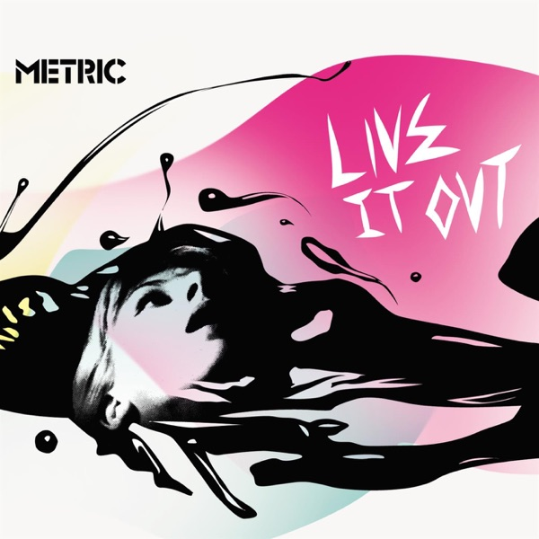

# Too Little Too Late — Metric

**Album:** Live It Out
**Accent:** `#ff2f92`

## Charge

<!-- What state does this song trigger? -->

## Sonic Attraction

<!-- What sound detail pulls you in? Rhythm, bass, vocal texture, distortion, switch, silence. -->

## Lyric/Vocal Detail

<!-- Any line, delivery, breath, pronunciation, or vocal moment worth preserving? -->

## Version of ulaş

<!-- What version of me does this song store? Time period, grind, breakup, desire, motion. -->

## Lore

<!-- Any personal history, repeated use, place, habit, person attached to this track? -->

## Reading

<!-- What do I think the song is doing or narrating? -->

## Comment

I have so much to say about this song, and this song has so much to say about me. So I'd rather keep it silent here. I'll just advise you to take a listen if you're in this page.
